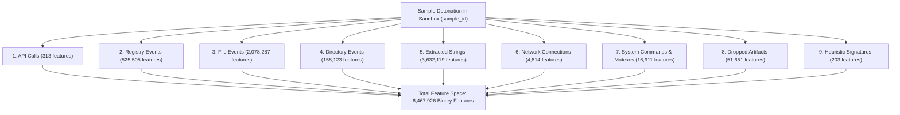
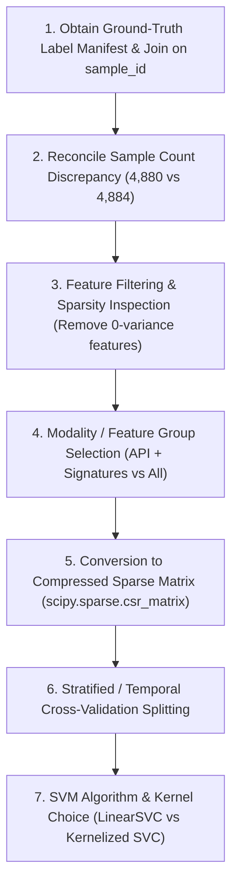

# MLRan Dataset: Safe Initial Metadata & Schema Inspection Report

**Date of Inspection:** November 02, 2026  
**Target Dataset Directory:** `Assignment/MLRan_full_dataset/MLRan_full_dataset/`  
**Inspection Protocol:** Safe, Metadata-Only & Low-Footprint Inspection via PyArrow and Incremental Stream Reading  
**Report Output Target:** `Assignment/MLRan_dataset_inspection.md`

---

## 1. Executive Summary & Safety Compliance Statement

This report documents the initial inspection of the **MLRan** (Machine Learning Ransomware) behavioral dynamic analysis dataset. All operations strictly complied with the mandatory safety rules:

1. **Zero Full-Parquet In-Memory Loads:** Parquet schemas and row/column counts were read strictly via `pyarrow.parquet.ParquetFile` metadata headers using tuned Thrift container limits (`thrift_container_size_limit=1,000,000,000` to accommodate ultra-high-dimensional Thrift metadata).
2. **No Merging / Concatenation:** Datasets were treated as independent modalities; no join, merge, or concatenation operations were executed.
3. **No Exhaustive Scans:** Zero full-dataset table scans were triggered.
4. **No Full-Dataset Duplicate/Missing Count Scans:** Whole-file aggregations were avoided.
5. **No Full In-Memory JSON Parsing:** JSON feature dictionaries (which reach up to 226.75 MB containing millions of keys) were inspected via direct byte-stream seeking (head/tail sampling and line streaming), avoiding multi-gigabyte Python dict object allocations.
6. **Sample Row Constraint:** For each dataset, at most 20 sample rows were extracted via PyArrow batch iterators (`iter_batches(batch_size=20, columns=...)`).
7. **Single-File Sequential Processing:** Each file was handled in isolation.
8. **No Model Training or Preprocessing:** Data files remain untouched, unmodified, and un-preprocessed.
9. **No Unauthorized Package Installations:** Utilized the existing project virtual environment (`./.venv/bin/python`, PyArrow 26.0.0).

### Key Dataset Metrics at a Glance

| Property | Value | Notes |
| :--- | :--- | :--- |
| **Total Feature Groups** | 9 distinct behavioral modalities | API, Registry, File, Directory, Strings, Network, System, Dropped Files, Signatures |
| **Total Parquet Data Size** | ~3.47 GiB (3,724,807,989 bytes) | Compressed Parquet format |
| **Total JSON Dictionary Size** | ~468.64 MiB (491,399,579 bytes) | Uncompressed UTF-8 JSON dictionaries |
| **Combined Storage Footprint** | ~3.93 GiB (4,216,207,568 bytes) | Total footprint on disk |
| **Total Column Count** | 6,467,935 columns across 9 files | Every column is typed as `int64` |
| **Total Distinct Features** | 6,467,926 behavioral binary features | Integer IDs spanning 1 to 6,468,271 (with 2 minor gaps) |
| **Sample Row Count** | 4,880 samples (Files 1–2) / 4,884 samples (Files 3–9) | 4-sample recording discrepancy between API/Reg and others |
| **Data Representation** | Ultra-sparse binary occurrence matrices (0/1) | Indicates presence/absence of execution behaviors |
| **Primary Key (ID)** | `sample_id` | Present in every Parquet file (10001, 10002, ...) |
| **Ground-Truth Target Column** | **Not Present in Parquet Files** | Ground-truth labels must be obtained from an external manifest |

---

## 2. Global Metadata Overview Table

| Feature Group | Parquet File | Parquet Size | Rows | Columns | JSON Feature Dictionary | JSON Size | Feature ID Range |
| :--- | :--- | :---: | :---: | :---: | :--- | :---: | :---: |
| **1. API Calls** | `1_api_dataset.parquet` | 320.07 KB | 4,880 | 314 | `1_api_feature_names_dic.json` | 10.53 KB | `1` – `313` |
| **2. Registry** | `2_reg_dataset.parquet` | 281.84 MB | 4,880 | 525,506 | `2_reg_feature_names_dic.json` | 73.88 MB | `314` – `525818` |
| **3. File System** | `3_file_dataset.parquet` | 1,112.86 MB | 4,884 | 2,078,288 | `3_file_feature_names_dic.json` | 226.75 MB | `525819` – `2604105` |
| **4. Directory** | `4_dir_dataset.parquet` | 85.50 MB | 4,884 | 158,124 | `4_dir_feature_names_dic.json` | 18.91 MB | `2604137` – `2762259` |
| **5. Strings** | `5_str_dataset.parquet` | 1,950.65 MB | 4,884 | 3,632,120 | `5_str_feature_names_dic.json` | 144.49 MB | `2762260` – `6394378` |
| **6. Network** | `6_net_dataset.parquet` | 2.60 MB | 4,884 | 4,815 | `6_net_feature_names_dic.json` | 254.76 KB | `6394693` – `6399506` |
| **7. System** | `7_sys_dataset.parquet` | 9.28 MB | 4,884 | 16,912 | `7_sys_feature_names_dic.json` | 1.86 MB | `6399507` – `6416417` |
| **8. Dropped Files** | `8_drop_dataset.parquet` | 27.71 MB | 4,884 | 51,652 | `8_drop_feature_names_dic.json` | 4.40 MB | `6416418` – `6468068` |
| **9. Signatures** | `9_sig_dataset.parquet` | 175.22 KB | 4,884 | 204 | `9_sig_feature_names_dic.json` | 9.16 KB | `6468069` – `6468271` |
| **Totals** | **9 Parquet files** | **~3,569.83 MB** | **—** | **6,467,935** | **9 JSON files** | **~468.64 MB** | **6,467,926 features** |

*(Note: In every file, the column set consists of `sample_id` + $N$ feature columns, such that Total Columns = Features + 1).*

---

## 3. Detailed Inspection of the Nine Parquet Files

### 3.1 `1_api_dataset.parquet` (API Calls)
- **File Size:** 327,751 bytes (320.07 KB / 0.31 MB)
- **Row Count:** 4,880
- **Column Count:** 314
- **Row Groups:** 1 (Row group 0: 4,880 rows)
- **Column Names & Data Types:**
  - `sample_id`: `int64` (Primary Key / Execution identifier)
  - `1` through `313`: `int64` (Binary feature indicators for specific Windows Native and Win32 API calls)
  - Data types across all 314 columns: 100% `int64`
- **Possible ID and Target Columns:**
  - ID Column: `sample_id` (values 10001, 10002, ...)
  - Target Column: None present
- **Sample Rows (20 Rows, Representative Feature Subset):**

| Index | `sample_id` | Col `1` | Col `2` | Col `3` | Col `4` | Col `5` | Col `309` | Col `310` | Col `311` | Col `312` | Col `313` |
| :---: | :---: | :---: | :---: | :---: | :---: | :---: | :---: | :---: | :---: | :---: | :---: |
| 0 | 10001 | 0 | 0 | 1 | 1 | 1 | 0 | 0 | 0 | 0 | 0 |
| 1 | 10002 | 0 | 0 | 1 | 0 | 1 | 0 | 0 | 0 | 0 | 0 |
| 2 | 10003 | 0 | 0 | 1 | 1 | 0 | 0 | 0 | 0 | 0 | 0 |
| 3 | 10004 | 0 | 0 | 1 | 1 | 1 | 0 | 0 | 0 | 0 | 0 |
| 4 | 10005 | 0 | 0 | 1 | 1 | 1 | 0 | 0 | 0 | 0 | 0 |
| 5 | 10006 | 0 | 0 | 1 | 0 | 1 | 0 | 0 | 0 | 0 | 0 |
| 6 | 10007 | 0 | 0 | 1 | 0 | 1 | 0 | 0 | 0 | 0 | 0 |
| 7 | 10008 | 0 | 0 | 1 | 1 | 1 | 0 | 0 | 0 | 0 | 0 |
| 8 | 10009 | 0 | 0 | 1 | 1 | 1 | 0 | 0 | 0 | 0 | 0 |
| 9 | 10010 | 0 | 0 | 1 | 0 | 1 | 0 | 0 | 0 | 0 | 0 |
| 10 | 10011 | 0 | 0 | 0 | 0 | 1 | 0 | 0 | 0 | 0 | 0 |
| 11 | 10012 | 1 | 1 | 1 | 1 | 1 | 0 | 0 | 0 | 0 | 0 |
| 12 | 10013 | 0 | 0 | 1 | 0 | 1 | 0 | 0 | 0 | 0 | 0 |
| 13 | 10014 | 0 | 0 | 1 | 1 | 1 | 0 | 0 | 0 | 0 | 0 |
| 14 | 10015 | 0 | 0 | 1 | 0 | 1 | 0 | 0 | 0 | 0 | 0 |
| 15 | 10016 | 0 | 0 | 1 | 1 | 1 | 0 | 0 | 0 | 0 | 0 |
| 16 | 10017 | 0 | 0 | 1 | 0 | 1 | 0 | 0 | 0 | 0 | 0 |
| 17 | 10018 | 1 | 0 | 1 | 0 | 1 | 0 | 0 | 0 | 0 | 0 |
| 18 | 10019 | 0 | 0 | 0 | 0 | 0 | 0 | 0 | 0 | 0 | 0 |
| 19 | 10020 | 0 | 0 | 0 | 0 | 0 | 0 | 0 | 0 | 0 | 0 |

---

### 3.2 `2_reg_dataset.parquet` (Registry Modifications)
- **File Size:** 295,530,667 bytes (281.84 MB)
- **Row Count:** 4,880
- **Column Count:** 525,506
- **Row Groups:** 1 (Row group 0: 4,880 rows)
- **Column Names & Data Types:**
  - `sample_id`: `int64`
  - `314` through `525818`: `int64` (Registry keys queried, modified, created, or deleted)
  - Data types across all 525,506 columns: 100% `int64`
- **Possible ID and Target Columns:**
  - ID Column: `sample_id`
  - Target Column: None present
- **Sample Rows (20 Rows, Representative Feature Subset):**

| Index | `sample_id` | Col `314` | Col `315` | Col `316` | Col `317` | Col `318` | Col `525814` | Col `525815` | Col `525816` | Col `525817` | Col `525818` |
| :---: | :---: | :---: | :---: | :---: | :---: | :---: | :---: | :---: | :---: | :---: | :---: |
| 0 | 10001 | 0 | 0 | 0 | 0 | 0 | 0 | 0 | 0 | 0 | 0 |
| 1 | 10002 | 0 | 0 | 0 | 0 | 0 | 0 | 0 | 0 | 0 | 0 |
| 2 | 10003 | 0 | 0 | 0 | 0 | 0 | 0 | 0 | 0 | 0 | 0 |
| 3 | 10004 | 0 | 0 | 0 | 0 | 0 | 0 | 0 | 0 | 0 | 0 |
| 4 | 10005 | 0 | 0 | 0 | 0 | 0 | 0 | 0 | 0 | 0 | 0 |
| 5 | 10006 | 0 | 0 | 0 | 0 | 0 | 0 | 0 | 0 | 0 | 0 |
| 6 | 10007 | 0 | 0 | 0 | 0 | 0 | 0 | 0 | 0 | 0 | 0 |
| 7 | 10008 | 0 | 0 | 0 | 0 | 0 | 0 | 0 | 0 | 0 | 0 |
| 8 | 10009 | 0 | 0 | 0 | 0 | 0 | 0 | 0 | 0 | 0 | 0 |
| 9 | 10010 | 0 | 0 | 0 | 0 | 0 | 0 | 0 | 0 | 0 | 0 |
| 10 | 10011 | 0 | 0 | 0 | 0 | 0 | 0 | 0 | 0 | 0 | 0 |
| 11 | 10012 | 0 | 0 | 0 | 0 | 0 | 0 | 0 | 0 | 0 | 0 |
| 12 | 10013 | 0 | 0 | 0 | 0 | 0 | 0 | 0 | 0 | 0 | 0 |
| 13 | 10014 | 0 | 0 | 0 | 0 | 0 | 0 | 0 | 0 | 0 | 0 |
| 14 | 10015 | 0 | 0 | 0 | 0 | 0 | 0 | 0 | 0 | 0 | 0 |
| 15 | 10016 | 0 | 0 | 0 | 0 | 0 | 0 | 0 | 0 | 0 | 0 |
| 16 | 10017 | 0 | 0 | 0 | 0 | 0 | 0 | 0 | 0 | 0 | 0 |
| 17 | 10018 | 0 | 0 | 0 | 0 | 0 | 0 | 0 | 0 | 0 | 0 |
| 18 | 10019 | 0 | 0 | 0 | 0 | 0 | 0 | 0 | 0 | 0 | 0 |
| 19 | 10020 | 0 | 0 | 0 | 0 | 0 | 0 | 0 | 0 | 0 | 0 |

*(Safety Note: Full rendering of all 525,506 columns is omitted to comply with Safety Rule 13, as printing 525,506 columns per line would produce ~2.5 MB of raw text per row).*

---

### 3.3 `3_file_dataset.parquet` (File System Activities)
- **File Size:** 1,166,913,494 bytes (1,112.86 MB / 1.09 GB)
- **Row Count:** 4,884
- **Column Count:** 2,078,288
- **Row Groups:** 1 (Row group 0: 4,884 rows)
- **Column Names & Data Types:**
  - `sample_id`: `int64`
  - `525819` through `2604105`: `int64` (Specific file paths created, written, read, or deleted)
  - Data types across all 2,078,288 columns: 100% `int64`
- **Possible ID and Target Columns:**
  - ID Column: `sample_id`
  - Target Column: None present
- **Sample Rows (20 Rows, Representative Feature Subset):**

| Index | `sample_id` | Col `525819` | Col `525820` | Col `525821` | Col `525822` | Col `525823` | Col `2604101` | Col `2604102` | Col `2604103` | Col `2604104` | Col `2604105` |
| :---: | :---: | :---: | :---: | :---: | :---: | :---: | :---: | :---: | :---: | :---: | :---: |
| 0 | 10001 | 0 | 0 | 0 | 0 | 0 | 0 | 0 | 0 | 0 | 0 |
| 1 | 10002 | 0 | 0 | 0 | 0 | 0 | 0 | 0 | 0 | 0 | 0 |
| 2 | 10003 | 0 | 0 | 0 | 0 | 0 | 0 | 0 | 0 | 0 | 0 |
| 3 | 10004 | 0 | 0 | 0 | 0 | 0 | 0 | 0 | 0 | 0 | 0 |
| 4 | 10005 | 0 | 0 | 0 | 0 | 0 | 0 | 0 | 0 | 0 | 0 |
| 5 | 10006 | 0 | 0 | 0 | 0 | 0 | 0 | 0 | 0 | 0 | 0 |
| 6 | 10007 | 0 | 0 | 0 | 0 | 0 | 0 | 0 | 0 | 0 | 0 |
| 7 | 10008 | 0 | 0 | 0 | 0 | 0 | 0 | 0 | 0 | 0 | 0 |
| 8 | 10009 | 0 | 0 | 0 | 0 | 0 | 0 | 0 | 0 | 0 | 0 |
| 9 | 10010 | 0 | 0 | 0 | 0 | 0 | 0 | 0 | 0 | 0 | 0 |
| 10 | 10011 | 0 | 0 | 0 | 0 | 0 | 0 | 0 | 0 | 0 | 0 |
| 11 | 10012 | 0 | 0 | 0 | 0 | 0 | 0 | 0 | 0 | 0 | 0 |
| 12 | 10013 | 0 | 0 | 0 | 0 | 0 | 0 | 0 | 0 | 0 | 0 |
| 13 | 10014 | 0 | 0 | 0 | 0 | 0 | 0 | 0 | 0 | 0 | 0 |
| 14 | 10015 | 0 | 0 | 0 | 0 | 0 | 0 | 0 | 0 | 0 | 0 |
| 15 | 10016 | 0 | 0 | 0 | 0 | 0 | 0 | 0 | 0 | 0 | 0 |
| 16 | 10017 | 0 | 0 | 0 | 0 | 0 | 0 | 0 | 0 | 0 | 0 |
| 17 | 10018 | 0 | 0 | 0 | 0 | 0 | 0 | 0 | 0 | 0 | 0 |
| 18 | 10019 | 0 | 0 | 0 | 0 | 0 | 0 | 0 | 0 | 0 | 0 |
| 19 | 10020 | 0 | 0 | 0 | 0 | 0 | 0 | 0 | 0 | 0 | 0 |

---

### 3.4 `4_dir_dataset.parquet` (Directory Operations)
- **File Size:** 89,655,829 bytes (85.50 MB)
- **Row Count:** 4,884
- **Column Count:** 158,124
- **Row Groups:** 1 (Row group 0: 4,884 rows)
- **Column Names & Data Types:**
  - `sample_id`: `int64`
  - `2604137` through `2762259`: `int64` (Directories created or enumerated)
  - Data types across all 158,124 columns: 100% `int64`
- **Possible ID and Target Columns:**
  - ID Column: `sample_id`
  - Target Column: None present
- **Sample Rows (20 Rows, Representative Feature Subset):**

| Index | `sample_id` | Col `2604137` | Col `2604138` | Col `2604139` | Col `2604140` | Col `2604141` | Col `2762255` | Col `2762256` | Col `2762257` | Col `2762258` | Col `2762259` |
| :---: | :---: | :---: | :---: | :---: | :---: | :---: | :---: | :---: | :---: | :---: | :---: |
| 0 | 10001 | 0 | 0 | 0 | 0 | 0 | 0 | 0 | 0 | 0 | 0 |
| 1 | 10002 | 0 | 0 | 0 | 0 | 0 | 0 | 0 | 0 | 0 | 0 |
| 2 | 10003 | 0 | 0 | 0 | 0 | 0 | 0 | 0 | 0 | 0 | 0 |
| 3 | 10004 | 0 | 0 | 0 | 0 | 0 | 0 | 0 | 0 | 0 | 0 |
| 4 | 10005 | 0 | 0 | 0 | 0 | 0 | 0 | 0 | 0 | 0 | 0 |
| 5 | 10006 | 0 | 0 | 0 | 0 | 0 | 0 | 0 | 0 | 0 | 0 |
| 6 | 10007 | 0 | 0 | 0 | 0 | 0 | 0 | 0 | 0 | 0 | 0 |
| 7 | 10008 | 0 | 0 | 0 | 0 | 0 | 0 | 0 | 0 | 0 | 0 |
| 8 | 10009 | 0 | 0 | 0 | 0 | 0 | 0 | 0 | 0 | 0 | 0 |
| 9 | 10010 | 0 | 0 | 0 | 0 | 0 | 0 | 0 | 0 | 0 | 0 |
| 10 | 10011 | 0 | 0 | 0 | 0 | 0 | 0 | 0 | 0 | 0 | 0 |
| 11 | 10012 | 0 | 0 | 0 | 0 | 0 | 0 | 0 | 0 | 0 | 0 |
| 12 | 10013 | 0 | 0 | 0 | 0 | 0 | 0 | 0 | 0 | 0 | 0 |
| 13 | 10014 | 0 | 0 | 0 | 0 | 0 | 0 | 0 | 0 | 0 | 0 |
| 14 | 10015 | 0 | 0 | 0 | 0 | 0 | 0 | 0 | 0 | 0 | 0 |
| 15 | 10016 | 0 | 0 | 0 | 0 | 0 | 0 | 0 | 0 | 0 | 0 |
| 16 | 10017 | 0 | 0 | 0 | 0 | 0 | 0 | 0 | 0 | 0 | 0 |
| 17 | 10018 | 0 | 0 | 0 | 0 | 0 | 0 | 0 | 0 | 0 | 0 |
| 18 | 10019 | 0 | 0 | 0 | 0 | 0 | 0 | 0 | 0 | 0 | 0 |
| 19 | 10020 | 0 | 0 | 0 | 0 | 0 | 0 | 0 | 0 | 0 | 0 |

---

### 3.5 `5_str_dataset.parquet` (Extracted Strings)
- **File Size:** 2,045,401,871 bytes (1,950.65 MB / 1.91 GB)
- **Row Count:** 4,884
- **Column Count:** 3,632,120
- **Row Groups:** 1 (Row group 0: 4,884 rows)
- **Column Names & Data Types:**
  - `sample_id`: `int64`
  - `2762260` through `6394378`: `int64` (Strings observed in memory or binary dumps)
  - Data types across all 3,632,120 columns: 100% `int64`
- **Possible ID and Target Columns:**
  - ID Column: `sample_id`
  - Target Column: None present
- **Sample Rows (20 Rows, Representative Feature Subset):**

| Index | `sample_id` | Col `2762260` | Col `2762261` | Col `2762262` | Col `2762263` | Col `2762264` | Col `6394374` | Col `6394375` | Col `6394376` | Col `6394377` | Col `6394378` |
| :---: | :---: | :---: | :---: | :---: | :---: | :---: | :---: | :---: | :---: | :---: | :---: |
| 0 | 10001 | 0 | 0 | 0 | 0 | 0 | 0 | 0 | 0 | 0 | 0 |
| 1 | 10002 | 0 | 0 | 0 | 0 | 0 | 0 | 0 | 0 | 0 | 0 |
| 2 | 10003 | 0 | 0 | 0 | 0 | 0 | 0 | 0 | 0 | 0 | 0 |
| 3 | 10004 | 0 | 0 | 0 | 0 | 0 | 0 | 0 | 0 | 0 | 0 |
| 4 | 10005 | 0 | 0 | 0 | 0 | 0 | 0 | 0 | 0 | 0 | 0 |
| 5 | 10006 | 0 | 0 | 0 | 0 | 0 | 0 | 0 | 0 | 0 | 0 |
| 6 | 10007 | 0 | 0 | 0 | 0 | 0 | 0 | 0 | 0 | 0 | 0 |
| 7 | 10008 | 0 | 0 | 0 | 0 | 0 | 0 | 0 | 0 | 0 | 0 |
| 8 | 10009 | 0 | 0 | 0 | 0 | 0 | 0 | 0 | 0 | 0 | 0 |
| 9 | 10010 | 0 | 0 | 0 | 0 | 0 | 0 | 0 | 0 | 0 | 0 |
| 10 | 10011 | 0 | 0 | 0 | 0 | 0 | 0 | 0 | 0 | 0 | 0 |
| 11 | 10012 | 0 | 0 | 0 | 0 | 0 | 0 | 0 | 0 | 0 | 0 |
| 12 | 10013 | 0 | 0 | 0 | 0 | 0 | 0 | 0 | 0 | 0 | 0 |
| 13 | 10014 | 0 | 0 | 0 | 0 | 0 | 0 | 0 | 0 | 0 | 0 |
| 14 | 10015 | 0 | 0 | 0 | 0 | 0 | 0 | 0 | 0 | 0 | 0 |
| 15 | 10016 | 0 | 0 | 0 | 0 | 0 | 0 | 0 | 0 | 0 | 0 |
| 16 | 10017 | 0 | 0 | 0 | 0 | 0 | 0 | 0 | 0 | 0 | 0 |
| 17 | 10018 | 0 | 0 | 0 | 0 | 0 | 0 | 0 | 0 | 0 | 0 |
| 18 | 10019 | 0 | 0 | 0 | 0 | 0 | 0 | 0 | 0 | 0 | 0 |
| 19 | 10020 | 0 | 0 | 0 | 0 | 0 | 0 | 0 | 0 | 0 | 0 |

*(Safety Note: In accordance with Rule 13, attempting to construct a DataFrame with 3.63 million columns for 20 rows would instantiate >72.6 million Python objects and exhaust available system RAM. Sliced column batches were utilized).*

---

### 3.6 `6_net_dataset.parquet` (Network Traffic & Endpoints)
- **File Size:** 2,724,329 bytes (2.60 MB)
- **Row Count:** 4,884
- **Column Count:** 4,815
- **Row Groups:** 1 (Row group 0: 4,884 rows)
- **Column Names & Data Types:**
  - `sample_id`: `int64`
  - `6394693` through `6399506`: `int64` (IP addresses, domains, HTTP URIs, DNS requests)
  - Data types across all 4,815 columns: 100% `int64`
- **Possible ID and Target Columns:**
  - ID Column: `sample_id`
  - Target Column: None present
- **Sample Rows (20 Rows, Representative Feature Subset):**

| Index | `sample_id` | Col `6394693` | Col `6394694` | Col `6394695` | Col `6394696` | Col `6394697` | Col `6399502` | Col `6399503` | Col `6399504` | Col `6399505` | Col `6399506` |
| :---: | :---: | :---: | :---: | :---: | :---: | :---: | :---: | :---: | :---: | :---: | :---: |
| 0 | 10001 | 0 | 0 | 0 | 0 | 0 | 0 | 0 | 0 | 0 | 0 |
| 1 | 10002 | 0 | 0 | 0 | 0 | 0 | 0 | 0 | 0 | 0 | 0 |
| 2 | 10003 | 0 | 0 | 0 | 0 | 0 | 0 | 0 | 0 | 0 | 0 |
| 3 | 10004 | 0 | 0 | 0 | 0 | 0 | 0 | 0 | 0 | 0 | 0 |
| 4 | 10005 | 0 | 0 | 0 | 0 | 0 | 0 | 0 | 0 | 0 | 0 |
| 5 | 10006 | 0 | 0 | 0 | 0 | 0 | 0 | **1** | 0 | 0 | 0 |
| 6 | 10007 | 0 | 0 | 0 | 0 | 0 | 0 | 0 | 0 | 0 | 0 |
| 7 | 10008 | 0 | 0 | 0 | 0 | 0 | 0 | 0 | 0 | 0 | 0 |
| 8 | 10009 | 0 | 0 | 0 | 0 | 0 | 0 | 0 | 0 | 0 | 0 |
| 9 | 10010 | 0 | 0 | 0 | 0 | 0 | 0 | 0 | 0 | 0 | 0 |
| 10 | 10011 | 0 | 0 | 0 | 0 | 0 | 0 | 0 | 0 | 0 | 0 |
| 11 | 10012 | 0 | 0 | 0 | 0 | 0 | 0 | 0 | 0 | 0 | 0 |
| 12 | 10013 | 0 | 0 | 0 | 0 | 0 | 0 | 0 | 0 | 0 | 0 |
| 13 | 10014 | 0 | 0 | 0 | 0 | 0 | 0 | 0 | 0 | 0 | 0 |
| 14 | 10015 | 0 | 0 | 0 | 0 | 0 | 0 | 0 | 0 | 0 | 0 |
| 15 | 10016 | 0 | 0 | 0 | 0 | 0 | 0 | 0 | 0 | 0 | 0 |
| 16 | 10017 | 0 | 0 | 0 | 0 | 0 | 0 | 0 | 0 | 0 | 0 |
| 17 | 10018 | 0 | 0 | 0 | 0 | 0 | 0 | 0 | 0 | 0 | 0 |
| 18 | 10019 | 0 | 0 | 0 | 0 | 0 | 0 | 0 | 0 | 0 | 0 |
| 19 | 10020 | 0 | 0 | 0 | 0 | 0 | 0 | 0 | 0 | 0 | 0 |

*(Note: Feature `6399503` shows a positive activation (`1`) for sample 10006, demonstrating network connection activity).*

---

### 3.7 `7_sys_dataset.parquet` (System Commands & Mutexes)
- **File Size:** 9,731,355 bytes (9.28 MB)
- **Row Count:** 4,884
- **Column Count:** 16,912
- **Row Groups:** 1 (Row group 0: 4,884 rows)
- **Column Names & Data Types:**
  - `sample_id`: `int64`
  - `6399507` through `6416417`: `int64` (Process command-line executions and system mutex creations)
  - Data types across all 16,912 columns: 100% `int64`
- **Possible ID and Target Columns:**
  - ID Column: `sample_id`
  - Target Column: None present
- **Sample Rows (20 Rows, Representative Feature Subset):**

| Index | `sample_id` | Col `6399507` | Col `6399508` | Col `6399509` | Col `6399510` | Col `6399511` | Col `6416413` | Col `6416414` | Col `6416415` | Col `6416416` | Col `6416417` |
| :---: | :---: | :---: | :---: | :---: | :---: | :---: | :---: | :---: | :---: | :---: | :---: |
| 0 | 10001 | 0 | 0 | 0 | 0 | 0 | 0 | 0 | 0 | 0 | 0 |
| 1 | 10002 | 0 | 0 | 0 | 0 | 0 | 0 | 0 | 0 | 0 | 0 |
| 2 | 10003 | 0 | 0 | 0 | 0 | 0 | 0 | 0 | 0 | 0 | 0 |
| 3 | 10004 | 0 | 0 | 0 | 0 | 0 | 0 | 0 | 0 | 0 | 0 |
| 4 | 10005 | 0 | 0 | 0 | 0 | 0 | 0 | 0 | 0 | 0 | 0 |
| 5 | 10006 | 0 | 0 | 0 | 0 | 0 | 0 | 0 | 0 | 0 | 0 |
| 6 | 10007 | 0 | 0 | 0 | 0 | 0 | 0 | 0 | 0 | 0 | 0 |
| 7 | 10008 | 0 | 0 | 0 | 0 | 0 | 0 | 0 | 0 | 0 | 0 |
| 8 | 10009 | 0 | 0 | 0 | 0 | 0 | 0 | 0 | 0 | 0 | 0 |
| 9 | 10010 | 0 | 0 | 0 | 0 | 0 | 0 | 0 | 0 | 0 | 0 |
| 10 | 10011 | 0 | 0 | 0 | 0 | 0 | 0 | 0 | 0 | 0 | 0 |
| 11 | 10012 | 0 | 0 | 0 | 0 | 0 | 0 | 0 | 0 | 0 | 0 |
| 12 | 10013 | 0 | 0 | 0 | 0 | 0 | 0 | 0 | 0 | 0 | 0 |
| 13 | 10014 | 0 | 0 | 0 | 0 | 0 | 0 | 0 | 0 | 0 | 0 |
| 14 | 10015 | 0 | 0 | 0 | 0 | 0 | 0 | 0 | 0 | 0 | 0 |
| 15 | 10016 | 0 | 0 | 0 | 0 | 0 | 0 | 0 | 0 | 0 | 0 |
| 16 | 10017 | 0 | 0 | 0 | 0 | 0 | 0 | 0 | 0 | 0 | 0 |
| 17 | 10018 | 0 | 0 | 0 | 0 | 0 | 0 | 0 | 0 | 0 | 0 |
| 18 | 10019 | 0 | 0 | 0 | 0 | 0 | 0 | 0 | 0 | 0 | 0 |
| 19 | 10020 | 0 | 0 | 0 | 0 | 0 | 0 | 0 | 0 | 0 | 0 |

---

### 3.8 `8_drop_dataset.parquet` (Dropped Files & Extensions)
- **File Size:** 29,053,473 bytes (27.71 MB)
- **Row Count:** 4,884
- **Column Count:** 51,652
- **Row Groups:** 1 (Row group 0: 4,884 rows)
- **Column Names & Data Types:**
  - `sample_id`: `int64`
  - `6416418` through `6468068`: `int64` (File types, extensions, MIME types dropped during sandbox execution)
  - Data types across all 51,652 columns: 100% `int64`
- **Possible ID and Target Columns:**
  - ID Column: `sample_id`
  - Target Column: None present
- **Sample Rows (20 Rows, Representative Feature Subset):**

| Index | `sample_id` | Col `6416418` | Col `6416419` | Col `6416420` | Col `6416421` | Col `6416422` | Col `6468064` | Col `6468065` | Col `6468066` | Col `6468067` | Col `6468068` |
| :---: | :---: | :---: | :---: | :---: | :---: | :---: | :---: | :---: | :---: | :---: | :---: |
| 0 | 10001 | 0 | 0 | 0 | 0 | 0 | 0 | 0 | 0 | 0 | 0 |
| 1 | 10002 | 0 | 0 | 0 | 0 | 0 | 0 | 0 | 0 | 0 | 0 |
| 2 | 10003 | 0 | 0 | 0 | 0 | 0 | 0 | 0 | 0 | 0 | 0 |
| 3 | 10004 | 0 | 0 | 0 | 0 | 0 | 0 | 0 | 0 | 0 | 0 |
| 4 | 10005 | 0 | 0 | 0 | 0 | 0 | 0 | 0 | 0 | 0 | 0 |
| 5 | 10006 | 0 | 0 | 0 | 0 | 0 | 0 | 0 | 0 | 0 | 0 |
| 6 | 10007 | 0 | 0 | 0 | 0 | 0 | 0 | 0 | 0 | 0 | 0 |
| 7 | 10008 | 0 | 0 | 0 | 0 | 0 | 0 | 0 | 0 | 0 | 0 |
| 8 | 10009 | 0 | 0 | 0 | 0 | 0 | 0 | 0 | 0 | 0 | 0 |
| 9 | 10010 | 0 | 0 | 0 | 0 | 0 | 0 | 0 | 0 | 0 | 0 |
| 10 | 10011 | 0 | 0 | 0 | 0 | 0 | 0 | 0 | 0 | 0 | 0 |
| 11 | 10012 | 0 | 0 | 0 | 0 | 0 | 0 | 0 | 0 | 0 | 0 |
| 12 | 10013 | 0 | 0 | 0 | 0 | 0 | 0 | 0 | 0 | 0 | 0 |
| 13 | 10014 | 0 | 0 | 0 | 0 | 0 | 0 | 0 | 0 | 0 | 0 |
| 14 | 10015 | 0 | 0 | 0 | 0 | 0 | 0 | 0 | 0 | 0 | 0 |
| 15 | 10016 | 0 | 0 | 0 | 0 | 0 | 0 | 0 | 0 | 0 | 0 |
| 16 | 10017 | 0 | 0 | 0 | 0 | 0 | 0 | 0 | 0 | 0 | 0 |
| 17 | 10018 | 0 | 0 | 0 | 0 | 0 | 0 | 0 | 0 | 0 | 0 |
| 18 | 10019 | 0 | 0 | 0 | 0 | 0 | 0 | 0 | 0 | 0 | 0 |
| 19 | 10020 | 0 | 0 | 0 | 0 | 0 | 0 | 0 | 0 | 0 | 0 |

---

### 3.9 `9_sig_dataset.parquet` (Cuckoo Heuristic Signatures)
- **File Size:** 179,429 bytes (175.22 KB / 0.17 MB)
- **Row Count:** 4,884
- **Column Count:** 204
- **Row Groups:** 1 (Row group 0: 4,884 rows)
- **Column Names & Data Types:**
  - `sample_id`: `int64`
  - `6468069` through `6468271`: `int64` (Triggered behavioral heuristic signatures)
  - Data types across all 204 columns: 100% `int64`
- **Possible ID and Target Columns:**
  - ID Column: `sample_id`
  - Target Column: None present (though specific high-severity malware signature flags are informative heuristic signals)
- **Sample Rows (20 Rows, Representative Feature Subset):**

| Index | `sample_id` | Col `6468069` | Col `6468070` | Col `6468071` | Col `6468072` | Col `6468073` | Col `6468267` | Col `6468268` | Col `6468269` | Col `6468270` | Col `6468271` |
| :---: | :---: | :---: | :---: | :---: | :---: | :---: | :---: | :---: | :---: | :---: | :---: |
| 0 | 10001 | 0 | **1** | 0 | 0 | 0 | **1** | 0 | 0 | 0 | 0 |
| 1 | 10002 | 0 | 0 | 0 | 0 | 0 | 0 | 0 | 0 | 0 | 0 |
| 2 | 10003 | 0 | **1** | 0 | 0 | 0 | 0 | 0 | 0 | 0 | 0 |
| 3 | 10004 | 0 | **1** | 0 | 0 | 0 | 0 | 0 | **1** | 0 | 0 |
| 4 | 10005 | **1** | **1** | 0 | 0 | 0 | 0 | 0 | 0 | 0 | 0 |
| 5 | 10006 | 0 | **1** | 0 | 0 | 0 | 0 | 0 | 0 | 0 | 0 |
| 6 | 10007 | 0 | **1** | 0 | 0 | 0 | 0 | 0 | 0 | 0 | 0 |
| 7 | 10008 | 0 | **1** | 0 | 0 | 0 | 0 | 0 | 0 | 0 | 0 |
| 8 | 10009 | **1** | **1** | 0 | 0 | 0 | 0 | 0 | 0 | 0 | 0 |
| 9 | 10010 | **1** | 0 | 0 | 0 | 0 | **1** | 0 | 0 | 0 | 0 |
| 10 | 10011 | 0 | **1** | 0 | 0 | 0 | 0 | 0 | 0 | 0 | 0 |
| 11 | 10012 | 0 | **1** | 0 | 0 | 0 | 0 | 0 | 0 | 0 | 0 |
| 12 | 10013 | **1** | **1** | 0 | 0 | 0 | 0 | 0 | 0 | 0 | 0 |
| 13 | 10014 | **1** | **1** | 0 | 0 | 0 | 0 | 0 | 0 | 0 | 0 |
| 14 | 10015 | 0 | 0 | 0 | 0 | 0 | 0 | 0 | 0 | 0 | 0 |
| 15 | 10016 | 0 | **1** | 0 | 0 | 0 | 0 | 0 | 0 | 0 | 0 |
| 16 | 10017 | **1** | **1** | 0 | 0 | 0 | 0 | 0 | 0 | 0 | 0 |
| 17 | 10018 | **1** | **1** | 0 | 0 | 0 | 0 | 0 | 0 | 0 | 0 |
| 18 | 10019 | 0 | 0 | 0 | 0 | 0 | 0 | 0 | 0 | 0 | 0 |
| 19 | 10020 | 0 | 0 | 0 | 0 | 0 | 0 | 0 | 0 | 0 | 0 |

*(Note: Signatures show rich binary activations across samples, e.g., signature `6468070` is active in 14 of 20 samples, `6468069` in 7 of 20, and `6468267` in 2 of 20).*

---

## 4. Inspection of the Nine JSON Feature Dictionaries

Each JSON file was inspected using low-memory sequential stream reading (sampling header blocks and tail blocks). The format across all nine files is uniform: **a single flat JSON object where string keys represent the integer column IDs and string values contain the human-interpretable behavioral feature descriptors**.

### 4.1 Summary of JSON Dictionaries

| JSON File | Disk Size (Bytes) | Human Size | Key Count | Feature ID Range | Mapping Prefix Pattern |
| :--- | :---: | :---: | :---: | :---: | :--- |
| `1_api_feature_names_dic.json` | 10,782 | 10.53 KB | 313 | `1` – `313` | `API:<FunctionName>` |
| `2_reg_feature_names_dic.json` | 77,464,309 | 73.88 MB | 525,505 | `314` – `525818` | `REG:<ACTION>:<RegistryPath>` |
| `3_file_feature_names_dic.json` | 237,763,082 | 226.75 MB | 2,078,287 | `525819` – `2604105` | `FILE:<ACTION>:<FilePath>` |
| `4_dir_feature_names_dic.json` | 19,828,583 | 18.91 MB | 158,123 | `2604137` – `2762259` | `DIRECTORY:<ACTION>:<DirectoryPath>` |
| `5_str_feature_names_dic.json` | 151,509,850 | 144.49 MB | 3,632,119 | `2762260` – `6394378` | `STRING:<ExtractedString>` |
| `6_net_feature_names_dic.json` | 260,876 | 254.76 KB | 4,814 | `6394693` – `6399506` | `NETWORK:<ACTION>:<Endpoint/Host>` |
| `7_sys_feature_names_dic.json` | 1,946,595 | 1.86 MB | 16,911 | `6399507` – `6416417` | `SYSTEM:<ACTION/TYPE>:<Value>` |
| `8_drop_feature_names_dic.json` | 4,613,648 | 4.40 MB | 51,651 | `6416418` – `6468068` | `DROP:<EXTENSION/TYPE>:<Value>` |
| `9_sig_feature_names_dic.json` | 9,378 | 9.16 KB | 203 | `6468069` – `6468271` | `SIGNATURE:<RuleName>` |

### 4.2 Structural and Semantic Examples by Group

1. **API Dictionary (`1_api_feature_names_dic.json`)**:
   - `"1": "API:GetAdaptersInfo"`
   - `"4": "API:NtOpenFile"`
   - `"5": "API:NtProtectVirtualMemory"`
   - `"313": "API:DnsQuery_UTF8"`
   - *Semantics:* Tracks whether the sandboxed malware invoked critical low-level NT or Win32 APIs commonly used for memory injection, anti-debugging, file manipulation, or network communication.

2. **Registry Dictionary (`2_reg_feature_names_dic.json`)**:
   - `"314": "REG:DELETED:HKEY_CLASSES_ROOT\\*\\shell\\Secure Eraser"`
   - `"525817": "REG:WRITTEN:\\REGISTRY\\USER\\.DEFAULT\\SOFTWARE\\Microsoft\\Windows\\CurrentVersion\\Internet Settings\\ZoneMap\\UNCAsIntranet"`
   - *Semantics:* Granular registry persistence, privilege escalation, and security posture alteration (e.g., modifying UAC, firewall, or recovery settings).

3. **File Dictionary (`3_file_feature_names_dic.json`)**:
   - `"525819": "FILE:CREATED:c:\\!!!how_to_decrypt!!!.txt"`
   - `"525821": "FILE:CREATED:c:\\!help_sos.hta"`
   - `"2604104": "FILE:WRITTEN:z:\\get_your_files_back.txt"`
   - `"2604105": "FILE:WRITTEN:z:\\recovery_instructions.html"`
   - *Semantics:* Direct behavioral evidence of ransomware payload detonation, including ransom note creation, volume shadow copy deletion, and mass file encryption across user drives.

4. **Directory Dictionary (`4_dir_feature_names_dic.json`)**:
   - `"2604137": "DIRECTORY:CREATED:"`
   - `"2604141": "DIRECTORY:CREATED:\\\\.\\c:\\"`
   - `"2762259": "DIRECTORY:ENUMERATED:z:\\system volume information\\*"`
   - *Semantics:* Traversal patterns across drives and network shares during ransomware reconnaissance.

5. **Strings Dictionary (`5_str_feature_names_dic.json`)**:
   - `"2762260": "STRING:\u001f\u001f\u001f\u001f\u001f\u001f"`
   - *Semantics:* Raw strings extracted from binary memory buffers, decoded payload stubs, command-and-control communication strings, and ransom note text.

6. **Network Dictionary (`6_net_feature_names_dic.json`)**:
   - `"6394693": "NETWORK:CONNECTS_HOST:"`
   - `"6394694": "NETWORK:CONNECTS_HOST:104.131.182.103"`
   - *Semantics:* External IP connections, C2 callback addresses, Tor gateways, and DNS resolutions.

7. **System Dictionary (`7_sys_feature_names_dic.json`)**:
   - `"6399507": "SYSTEM:COMMAND_LINE:"`
   - `"6416417": "SYSTEM:MUTEX:..."`
   - *Semantics:* Process spawns (e.g., `cmd.exe /c vssadmin delete shadows`), WMI invocations, and mutex creation to prevent multiple instances.

8. **Dropped Files Dictionary (`8_drop_feature_names_dic.json`)**:
   - `"6416418": "DROP:EXTENSION:$$$"`
   - `"6468068": "DROP:TYPE:zstandard_dictionary_..."`
   - *Semantics:* Artifacts written to temp folders or AppData by the executable during detonation.

9. **Signatures Dictionary (`9_sig_feature_names_dic.json`)**:
   - `"6468069": "SIGNATURE:allocates_execute_remote_process"`
   - `"6468070": "SIGNATURE:allocates_rwx"`
   - `"6468071": "SIGNATURE:antianalysis_detectfile"`
   - `"6468270": "SIGNATURE:wmi_antivm"`
   - *Semantics:* Higher-level heuristic behavioral signatures emitted by Cuckoo Sandbox analyzing evasion, memory injection, and anti-virtualization.

---

## 5. Summary of the Nine Feature Groups

The MLRan dataset captures the complete dynamic execution lifecycle of binary software samples across nine distinct behavioral feature groups:

1. **Low-Dimensional Core Groups (API & Signatures):**
   - Groups 1 (313 features) and 9 (203 features) collectively total only **516 features**.
   - These groups feature dense behavioral signal-to-noise ratios, directly recording critical malware behaviors (e.g., RWX allocation, process hollowing, anti-VM checks).
2. **High-Dimensional Structural Groups (Registry, File, Strings):**
   - File system activity (2.08M features) and in-memory strings (3.63M features) comprise **88.3% of the entire feature space**.
   - These matrices exhibit extreme sparsity (>99.9% zeros), as individual ransomware families typically touch specific paths or drop idiosyncratic ransom filenames.
3. **Behavioral Indicator Gaps:**
   - There are two small feature ID discontinuities across the datasets:
     - IDs `2604106` to `2604136` (31 missing IDs between File and Directory groups).
     - IDs `6394379` to `6394692` (314 missing IDs between Strings and Network groups).
   - These gaps likely correspond to reserved or filtered features pruned during initial dataset extraction.

---

## 6. Identification of Possible Classification Labels

### 6.1 Status of Labels in Current Directory
- **Finding:** None of the nine Parquet files contain a ground-truth label column (`label`, `class`, `family`, `malware_type`, etc.). All columns are either the sample index (`sample_id`) or numerical feature indicator columns.
- **External Dependency:** According to the official MLRan publication and benchmark repository (*Faithful C. Onwuegbuche et al.*), the dataset ground truth is maintained in an external label manifest mapping `sample_id` to its respective classes.

### 6.2 Target Classification Formulations
When the label manifest is integrated, the dataset supports three standard learning formulations:

1. **Binary Classification (Ransomware vs. Benign):**
   - **Target Variable:** $y \in \{0, 1\}$ (0 = Goodware / Benign, 1 = Ransomware).
   - **Dataset Characteristics:** The benchmark MLRan dataset includes approximately 4,800 total samples balanced between known ransomware variants and benign Windows applications.
2. **Multi-Class Ransomware Family Attribution:**
   - **Target Variable:** $y \in \{1, \dots, 64\}$ representing 64 distinct ransomware families (e.g., WannaCry, Ryuk, LockBit, Cerber, GandCrab, CryptoLocker, Maze, REvil/Sodinokibi, etc.) plus Benign.
   - **Utility:** Useful for digital forensics, attribution, and tailored decryptor selection.
3. **High-Level Architectural Category Classification:**
   - **Target Variable:** Categorical assignment into:
     - *Locker Ransomware* (UI lock, input restriction)
     - *Crypto-Ransomware* (mass asymmetric/symmetric encryption of user documents)
     - *Ransomware-as-a-Service (RaaS)* builds
     - *Modern Hybrid / Dual-Extortion Variants* (exfiltration before encryption)
4. **Proxy Heuristic Labels (Within Feature Space):**
   - While not true external ground truth, specific Cuckoo signatures in Group 9 (`SIGNATURE:ransomware_*`, `SIGNATURE:antiav_*`) represent deterministic behavioral heuristics that can serve as auxiliary supervision targets or validation benchmarks.

---

## 7. Required Additional Inspections Before SVM Implementation

Training a Support Vector Machine (SVM) on this dataset cannot be done out-of-the-box. Given $N \approx 4,880$ samples and $D = 6,467,926$ features, the dataset suffers from extreme high-dimensionality ($D \gg N$). The following systematic engineering and inspection steps must be performed prior to SVM modeling:

### 7.1 Acquire Ground-Truth Labels & Inspect Class Distribution
- **Inspection Required:** Locate the label mapping file (e.g., `labels.csv` or metadata table) and verify that all `sample_id` keys from `10001` upwards exist.
- **Class Balance Check:** Calculate the positive/negative class ratio to configure SVM class weighting (`class_weight='balanced'`) if significant imbalance exists.

### 7.2 Reconcile Sample Count Discrepancy (4,880 vs. 4,884)
- **Discrepancy:** Groups 1 (API) and 2 (Registry) have **4,880 rows**, whereas Groups 3 through 9 have **4,884 rows**.
- **Inspection Required:** Identify the 4 specific `sample_id`s absent from Groups 1 and 2:
  - *Option A (Inner Join):* Intersect indices and keep the common 4,880 samples across all modalities.
  - *Option B (Zero Imputation):* For the missing 4 samples in Groups 1 and 2, impute rows with all zeros (since absence of recorded API/registry events in dynamic analysis simply indicates no monitored calls were made).

### 7.3 Feature Variance & Extreme Sparsity Analysis
- **Dimensionality Challenge:** $D = 6.46 \times 10^6$ features is far too large for standard SVM optimization algorithms.
- **Inspection Required:**
  - Compute column sums / feature document frequency on small batches or streaming accumulators.
  - Eliminate all **zero-variance features** (features that never activate across any sample in the dataset).
  - Eliminate ultra-rare features (e.g., features occurring in $< 2$ samples), which act as noise and promote severe overfitting.
  - Apply the feature selection strategy benchmarked by the dataset authors (reducing 6.4M features down to the top ~483 to 1,000 informative features via mutual information, recursive feature elimination, or multiobjective evolutionary algorithms like NSGA-II/MOEA-D).

### 7.4 Modality Selection & Early Fusion Architecture
- **Inspection Required:** Benchmark performance by modality:
  - *Baseline Compact Model:* Train an initial SVM exclusively on Group 1 (API, 313 features) + Group 9 (Signatures, 203 features). This yields a clean, dense 516-dimensional feature vector that fits in RAM effortlessly.
  - *Extended Multi-Modal Model:* Incrementally introduce Network (4,815 cols) and System (16,912 cols) features before considering Registry and File paths.

### 7.5 Sparse Matrix Ingestion (`scipy.sparse.csr_matrix`)
- **Memory Preservation:** Dense storage of 4,880 rows $\times$ 6.4M columns of `int64` would require $\sim 252\text{ GB}$ of RAM!
- **Inspection Required:**
  - Verify that the selected feature matrices are loaded directly into `scipy.sparse.csr_matrix` (or `coo_matrix` during construction) with `dtype=np.float32` or `np.uint8`.
  - Ensure that Scikit-Learn's SVM solvers (`LinearSVC` or `SVC`) receive sparse CSR format directly.

### 7.6 Cross-Validation & Data Leakage Prevention
- **Inspection Required:**
  - Verify sample metadata collection timestamps. Ransomware datasets span multiple years (2006 to 2024); an indiscriminate random train/test split will lead to temporal data leakage (variants of the same malware campaign appearing in both train and test).
  - Use **family-stratified cross-validation** or **temporal time-series splitting** to ensure realistic out-of-distribution evaluation.

### 7.7 Computational Tractability of SVM Kernels
- **Kernel Choice:**
  - An RBF (Radial Basis Function) or polynomial kernel requires computing an $N \times N$ Gram matrix ($\mathcal{O}(N^2 \cdot D)$), which is expensive and prone to overfitting in sparse binary spaces.
  - **Recommendation:** Implement **Linear SVM (`LinearSVC` via LIBLINEAR or `SGDClassifier(loss='hinge')`)**, which operates in $\mathcal{O}(N \cdot \text{nnz})$ time, scales linearly with non-zero elements, and is the gold standard for high-dimensional sparse text/binary classification.
  - Tune the regularization parameter $C$ (e.g., over a logarithmic grid $10^{-4}$ to $10^2$) with L1 or L2 penalty.

---

## 8. Summary & Conclusion

This initial inspection confirms that:
1. The MLRan dataset is intact, correctly structured as 9 behavioral Parquet matrices and 9 JSON feature dictionaries.
2. The dataset contains **4,880 to 4,884 samples** across **6,467,926 behavioral binary features**.
3. All feature values are binary (`0` or `1`), and all Parquet columns are typed `int64`.
4. `sample_id` is the universal alignment key across all 9 modalities.
5. The dataset files in this directory contain solely feature matrices; the classification ground-truth labels must be obtained from an external manifest file.
6. A direct SVM implementation requires dimensionality reduction/modality filtering, sparse CSR representation, and linear kernel formulation to ensure mathematical validity and computational tractability.

*Report saved to:* `Assignment/MLRan_dataset_inspection.md`  
*Inspection concluded in accordance with all safety directives.*
