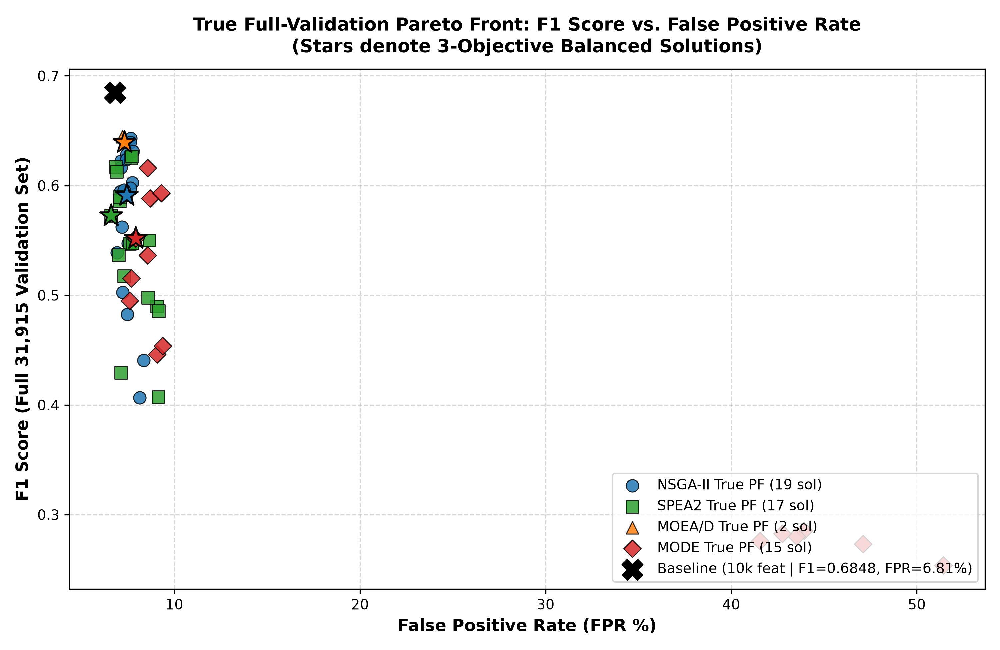
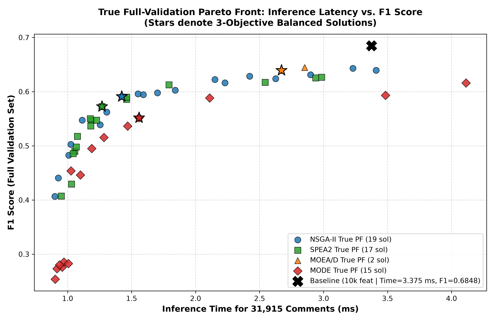
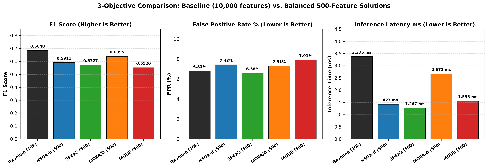
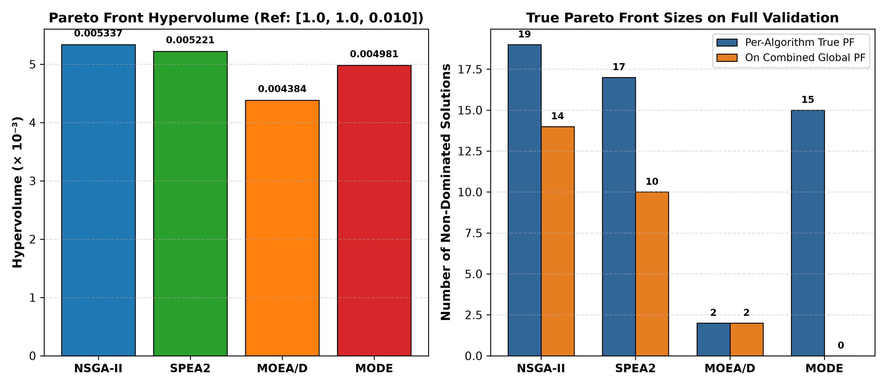

<div align="center">

# Multi-Objective Evolutionary Feature Selection for Toxic Comment Classification
### Soft Computing Final Project

[](https://www.python.org/)
[](https://scikit-learn.org/)
[](https://pymoo.org/)
[](https://opensource.org/licenses/MIT)
[]()

<p align="center">
  <b>95.0% Dimensionality Reduction</b> (10,000 $\to$ 500 Features) &bull; 
  <b>Four State-of-the-Art MOEAs Benchmarked</b> &bull; 
  <b>Real-Time Fast Live Demonstration</b>
</p>

</div>

---

## 📌 Executive Summary

This repository contains the complete experimental framework and findings for our **Soft Computing** project on high-dimensional multi-objective evolutionary feature selection. Using the **Jigsaw Toxic Comment Classification** dataset (159,571 comments), we investigate whether an aggressive **95% reduction in vocabulary** (compressing 10,000 TF-IDF features down to **exactly 500 features**) can retain high toxic detection capability while simultaneously reducing false alarms on benign users and cutting inference latency.

We formulate feature selection as a strict 3-objective constrained optimization problem and benchmark four major evolutionary paradigms:
1. **NSGA-II** (Non-dominated Sorting Genetic Algorithm II)
2. **SPEA2** (Strength Pareto Evolutionary Algorithm 2)
3. **MOEA/D** (Multi-Objective Evolutionary Algorithm based on Decomposition)
4. **MODE** (Multi-Objective Differential Evolution)

All candidate models are evaluated using `LinearSVC(class_weight="balanced", C=1.0, random_state=42)` across the full **31,915-sample validation partition**.

---

## 🎯 The Three Optimization Objectives

$$\begin{aligned}
\min f_1 &= 1.0 - \text{F1 Score} && \text{(Classification Quality on Minority Toxic Class)} \\
\min f_2 &= \text{FPR} = \frac{\text{FP}}{\text{FP} + \text{TN}} && \text{(False Alarm Suppression on Benign Users)} \\
\min f_3 &= \text{Inference Time (seconds)} && \text{(Computational Latency across 31,915 Comments)}
\end{aligned}$$

- **Strict Equality Constraint**: Every candidate solution must satisfy $\sum_{i=1}^{10000} x_i = 500$ via deterministic repair. Feature count is maintained as an exact constraint rather than an arbitrary fourth objective.

---

## 📊 Authoritative Comparison Table

All evolutionary algorithms operate under identical initial populations and evaluation budgets ($N=28, G=20$) with **exactly 500 selected features**. Metrics are evaluated on the complete **31,915 validation samples**.

| Algorithm | Features | Balanced F1 | Balanced FPR | Balanced Latency | Final Pareto Front | Hypervolume ($\mathbf{r}=[1,1,0.01]$) | Search Runtime | Best F1 (Extremal) | Best FPR (Extremal) |
| :--- | :---: | :---: | :---: | :---: | :---: | :---: | :---: | :---: | :---: |
| **Baseline (LinearSVC)** | 10,000 | **0.6848** | 6.81% | 3.375 ms | *N/A* | *N/A* | *N/A* | 0.6848 | 6.81% |
| **NSGA-II (Winner)** | **500** | **0.5911** | **7.43%** | **1.423 ms** | **19** | **0.00533716** | 249.4 s | 0.6430 (FPR 7.65%) | 6.91% (F1 0.5389) |
| **SPEA2** | **500** | 0.5727 | **6.58%** | **1.267 ms** | 17 | 0.00522081 | 220.7 s | 0.6267 (FPR 7.70%) | **6.58%** (F1 0.5727) |
| **MOEA/D** | **500** | 0.6395 | 7.31% | 2.671 ms | 2 | 0.00438351 | 269.8 s | **0.6446** (FPR 7.19%) | 7.19% (F1 0.6446) |
| **MODE** | **500** | 0.5520 | 7.91% | 1.558 ms | 15 | 0.00498118 | 235.1 s | 0.6160 (FPR 8.56%) | 7.59% (F1 0.4949) |

> **Balanced Operating Point**: Determined via minimum Euclidean distance to the normalized ideal point $(0, 0, 0)$ across $[1-\text{F1}, \text{FPR}, \text{Inference\_Time}]$.

---

## 🏆 Key Findings & Selected Winner

### 🥇 Overall Winner: **NSGA-II**
- **Optimal Balance**: Candidate #24 achieved the closest distance to the ideal point ($d^* = 0.2096$), retaining $\text{F1} = 0.5911$, $\text{FPR} = 7.43\%$, and slashing prediction latency by **57.8%** ($1.423\text{ ms}$ vs. $3.375\text{ ms}$).
- **Maximum Hypervolume**: NSGA-II achieved the highest hypervolume ($0.00533716$), capturing **99.2%** of the combined 4-algorithm global frontier.
- **Global Frontier Dominance**: Out of 26 non-dominated solutions on the combined global Pareto front, NSGA-II contributed **14 solutions (53.8%)**.

### 🔍 Specialized Algorithmic Strengths:
- **Best False-Positive Suppression (SPEA2)**: SPEA2 Candidate #8 achieved **$\text{FPR} = 6.58\%$**, **outperforming the 10,000-feature baseline** ($6.81\%$). If the engineering priority is minimizing censorship on civil users, SPEA2 is the optimal specialist.
- **Peak Classification Accuracy (MOEA/D)**: MOEA/D Candidate #17 achieved the single highest F1 score among all 500-feature models (**$\text{F1} = 0.6446$**, retaining **94.1%** of baseline F1). However, its decomposition approach collapsed into a localized cluster (lowest hypervolume: $0.00438351$).

---

## 📈 Visualizations

### 1. True Full-Validation Pareto Front (F1 Score vs. False Positive Rate)
<p align="center">
  
</p>

### 2. Inference Latency vs. Classification Performance
<p align="center">
  
</p>

### 3. Baseline (10,000 Features) vs. 500-Feature Balanced Solutions
<p align="center">
  
</p>

### 4. Hypervolume & Pareto Front Size Distribution
<p align="center">
  
</p>

---

## 📂 Repository Structure

```text
├── Soft_Computing_Project_Demo.ipynb   # Portable live demo notebook (Colab / Kaggle / Local)
├── demo.py                             # Fast 6-second live terminal demonstration script
├── run_evolutionary_experiment.py      # Main evolutionary experiment runner (20 gens, 4 algos)
├── audit_and_correct.py                # Post-search Pareto audit, hypervolume & plot generation
├── baseline_classifier.py              # Baseline LinearSVC evaluation script
├── make_processed_sample.py            # Generates the 100-row inspection sample CSV
├── make_bundle.py                      # Packages the ~83 MB Colab/Kaggle distribution ZIP
├── feature_names.txt                   # Complete 10,000 TF-IDF vocabulary tokens
├── final_algorithm_comparison.csv      # Audited final comparison table
├── final_pareto_solutions.csv          # 53 true full-validation Pareto solutions
├── final_analysis.json                 # Machine-readable experiment and normalization data
├── selected_features_*_balanced.{npy,txt} # Selected 500-feature indices & tokens per algorithm
├── processed_data/
│   └── processed_sample.csv            # 100-row sample CSV with tfidf_* headers & target (2 MB)
└── plots/                              # High-resolution publication comparison figures
    ├── pareto_f1_vs_fpr.png
    ├── pareto_f1_vs_inference_time.png
    ├── baseline_vs_evolutionary_comparison.png
    ├── hypervolume_comparison.png
    └── algorithm_convergence.png
```

---

## 🚀 Quickstart & Execution

### Prerequisites
Clone the repository and set up a Python virtual environment:
```bash
git clone https://github.com/<your-username>/SCProject.git
cd SCProject

python3 -m venv .venv
source .venv/bin/activate
pip install numpy scipy scikit-learn pandas matplotlib pymoo deap
```

### 1. Fast Terminal Live Demonstration (~6 Seconds)
Executes live training and evaluation of the baseline and all four 500-feature models:
```bash
python demo.py
```

### 2. Interactive Jupyter Demonstration Notebook
Open [`Soft_Computing_Project_Demo.ipynb`](Soft_Computing_Project_Demo.ipynb) locally, on **Google Colab**, or on **Kaggle**:
- Evaluates models live on all 31,915 validation samples in **~6.5 seconds**.
- Auto-detects local, `/content/`, or `/kaggle/input/` paths.
- Renders comparison tables and high-resolution figures inline.

### 3. Re-Running the Full Evolutionary Search (~16 Minutes)
To run the evolutionary optimization from scratch across all 20 generations for all four algorithms:
```bash
python run_evolutionary_experiment.py
python audit_and_correct.py
```

---

## 💾 Dataset & Artifact Management

- **Human-Readable Sample CSV**: [`processed_data/processed_sample.csv`](processed_data/processed_sample.csv) (100 rows × 10,001 columns) is committed directly to this repository for instant spreadsheet inspection. All feature columns are prefixed with `tfidf_` (e.g., `tfidf_target`, `tfidf_you`) and the final column is `target`.
- **Large Data Files Excluded from Git**: In accordance with GitHub file size recommendations, the full dense CSV files (`processed_train.csv` ~2.5 GB, `processed_validation.csv` ~0.6 GB), raw text archives, and sparse matrix binaries (`X_train.npz` ~66 MB) are kept in `.gitignore`.
- **Pre-Packaged Demo Archive**: Use `python make_bundle.py` to create `Soft_Computing_Project_Demo_Bundle.zip` (~83 MB), which contains the complete self-contained package ready for drag-and-drop upload to Google Colab or Kaggle.

---

## 🔬 Methodological Transparency & Limitations

- **Search-Time Evaluation Subset**: To enable multi-generational search of four algorithms within ~16 minutes on standard laptop hardware, evolutionary fitness evaluations utilized a fixed stratified subset of 8,000 samples drawn from the validation split. Candidate models were subsequently evaluated on the complete 31,915-sample validation partition. The two partitions partially overlap; this is documented as an acknowledged methodological limitation.
- **Decomposition Behavior in MOEA/D**: Fixed Tchebycheff decomposition with neighborhood size $T=6$ led to rapid convergence into a localized high-F1 cluster, limiting frontier spread across the latency dimension.

---

## 📜 Citation & Credits

- **Dataset**: [Jigsaw Toxic Comment Classification Challenge (Kaggle)](https://www.kaggle.com/c/jigsaw-toxic-comment-classification-challenge)
- **Frameworks**: Built using [scikit-learn](https://scikit-learn.org/), [Pymoo](https://pymoo.org/), and [SciPy](https://scipy.org/).

---

<div align="center">
  <b>Developed for Soft Computing (CSE / AI)</b>
</div>
